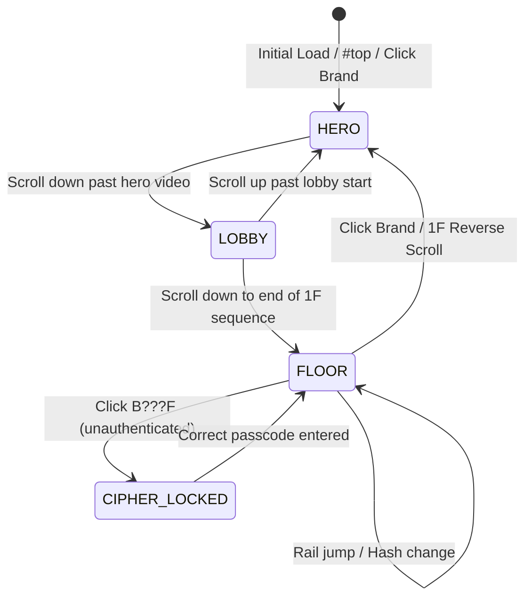

# TESHIMA LAB Portfolio — Clean Architecture Guide

## 1. Overview & Architecture Philosophy

TESHIMA LAB Portfolio is a cinematic, 6-floor spatial interactive portfolio built entirely with vanilla web standards (HTML5, Modern CSS, ES Modules) and zero third-party framework dependencies.

The codebase adheres to strict Clean Architecture and Single Responsibility Principles (SRP):
- **Zero Monolithic Sprawl**: Previously a 2,082-line single IIFE (`scene.js`), now decomposed into dedicated, cohesive ES modules under `assets/js/scene/`.
- **Pure Native ES Modules**: Browser-native `import`/`export` without mandatory bundling or transpilation overhead.
- **Data & Logic Separation**: Raw image URLs and metadata isolated into `assets/data/portfolio-images.json`.
- **Unified Hardware Detection**: Multi-agent device detection unified into `assets/js/device.js`.
- **Zero Console Regressions**: 0 console errors and 0 warnings verified across all pages.

---

## 2. Directory & Module Structure

```text
TESHIMA_LAB_portfolio/
├── index.html                   # Main 6-floor cinematic stage
├── about.html                   # 1F About / Spatial 3D Sphere page
├── lp.html                      # B2F Continuous-scroll Landing Page
├── presentation.html            # B1F 3D Slide Deck
├── other.html                   # B???F Secret Spatial Archive
│
├── scene.js                     # Root proxy entrypoint (imports assets/js/scene/main.js)
├── script.js                    # Minimal page lifecycle and typography loader
├── style.css                    # Base styling for about / other spatial galleries
├── scene.css                    # Cinematic stage and modal overlay styles
├── lp.css                       # LP-specific scroll layout and theme band styles
├── presentation.css             # Presentation deck 3D transitions
│
└── assets/
    ├── css/
    │   └── slides-shared.css    # Unified shared styles for LP & Presentation decks
    ├── data/
    │   ├── portfolio-images.json # Isolated 164-item portfolio image dataset
    │   └── portfolio-images.js   # ES Module wrapper for image dataset
    ├── js/
    │   ├── device.js            # Unified device & touch capability detection
    │   ├── escher-grid.js       # Shared logarithmic spiral conformal grid math
    │   └── scene/               # Modularized Stage Architecture Subsystems
    │       ├── config.js        # Floor definitions, asset paths, constants
    │       ├── dom.js           # Cached DOM query references
    │       ├── state.js         # Reactive central runtime store
    │       ├── blob-cache.js    # In-memory video Blob cache with LRU eviction
    │       ├── cenotaph.js      # Hero Cenotaph transform & opacity interpolation
    │       ├── lobby.js         # 1F About sequence canvas scrubbing engine
    │       ├── scrub-engine.js  # Dual hero & floor dolly video scrubber
    │       ├── hotspots.js      # Stage portal hotspot coverage calculation
    │       ├── atom.js          # B2F Atom doll interaction & clipboard copy
    │       ├── modals.js        # HAL 9000 Cipher terminal & Credit modal
    │       ├── navigation.js    # Floor transitions, elevator router, and hash sync
    │       ├── input.js         # Wheel, touch, pan, keyboard, and resize listeners
    │       └── main.js          # Main orchestrator & lifecycle bootstrap
    ├── scenes/                  # WebP keyframe plate images
    ├── video/                   # 1080p MP4 dolly and hero video assets
    └── fonts/                   # Local Japanese & display web fonts
```

---

## 3. State Machine & Transition Flow

The stage operates on an explicit 3-state state machine:



### State Definitions
1. **`hero`**: Entrance video scrubbed via scroll/touch/arrow keys. The `CENOTAPH for` title scales, blurs, and shifts based on playback position (`cenotaph.js`).
2. **`lobby`**: Canvas 2D image sequence (`lobby.js`) scrubbed down to the 1F guidebook desk.
3. **`floor`**: 6 distinct dolly-in video routes (`scrub-engine.js`) landing on destination floor plates with interactive portals (`hotspots.js`).

---

## 4. Subsystem Responsibilities

| Subsystem Module | File Path | Core Responsibility |
|---|---|---|
| **Config** | `assets/js/scene/config.js` | Floor descriptors, CDN/local asset paths, viewport baseline constants (`1920x1080`). |
| **DOM Store** | `assets/js/scene/dom.js` | Single-query DOM caching to prevent repeated selector overhead. |
| **State Store** | `assets/js/scene/state.js` | Central `runtime` state container (`state`, `cur`, `token`, `busy`, `platePanX`, `platePanY`). |
| **Blob Cache** | `assets/js/scene/blob-cache.js` | Memory-efficient video blob caching with automatic `URL.revokeObjectURL` eviction for iOS RAM protection. |
| **Scrub Engine** | `assets/js/scene/scrub-engine.js` | Frame-locked video decoder syncing with smooth requestAnimationFrame interpolation. |
| **Lobby Canvas** | `assets/js/scene/lobby.js` | High-performance 2D canvas frame sequence renderer with dirty tracking. |
| **Hotspots** | `assets/js/scene/hotspots.js` | Mathematical viewport `cover` rect calculation syncing HTML hitboxes to video end frames. |
| **Atom Doll** | `assets/js/scene/atom.js` | B2F secret clue trigger: bobblehead CSS physics + keyword clipboard copy. |
| **Modals** | `assets/js/scene/modals.js` | HAL 9000 optic eye pulse, encrypted passcode verification (24-hour persistence), and credits. |
| **Navigation** | `assets/js/scene/navigation.js` | Floor jump orchestration, dip-to-black transitions, history `replaceState` sync. |
| **Input** | `assets/js/scene/input.js` | Wheel, touch gestures, mouse drag-to-pan, and keyboard shortcuts (1-6, Space, Esc, Arrows). |
| **Main** | `assets/js/scene/main.js` | Orchestrator tying subsystems together, registering bfcache/visibilitychange listeners. |

---

## 5. Security & Authentication Model

The restricted floor (`B???F OTHER`) is protected by a client-side gate:
- Direct URL entry (`#other`) or rail selection is intercepted immediately.
- Verification requires entering the passcode `hungryart` (or `ハングリーアート`).
- Upon success, an expiring session record is committed to `localStorage` (valid for 24 hours), enabling subsequent direct access without re-prompting.

---

## 6. Responsive 5-State Verification Protocol

All layouts are verified against the 5 canonical viewports using Chrome DevTools MCP:
1. **PC Fluid**: `1440 × 900` (zero `overflow-x`, fluid content scaling)
2. **Mobile Portrait**: `390 × 844` (touch drag panning enabled, compact UI)
3. **Mobile Landscape**: `844 × 390` (fixed center coordinates, safe area padding)
4. **Tablet Portrait**: `768 × 1024` (responsive rail scaling, modal auto-fit)
5. **Tablet Landscape**: `1024 × 768` (full desktop-grade visual parity)
